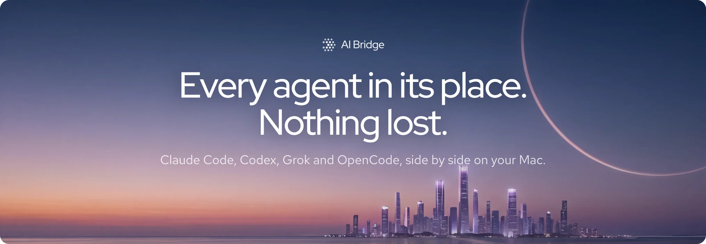
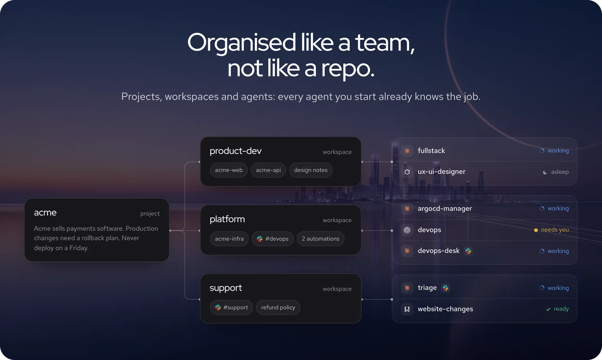
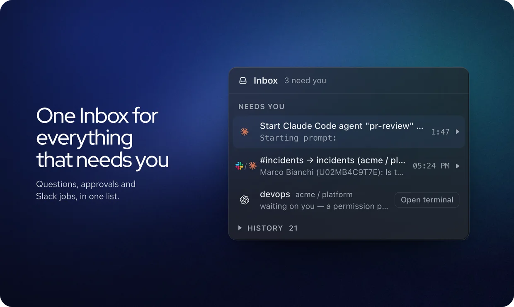
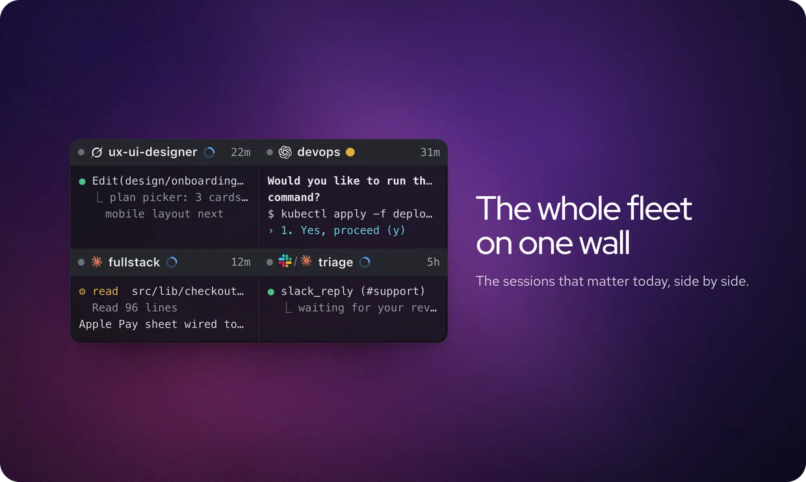
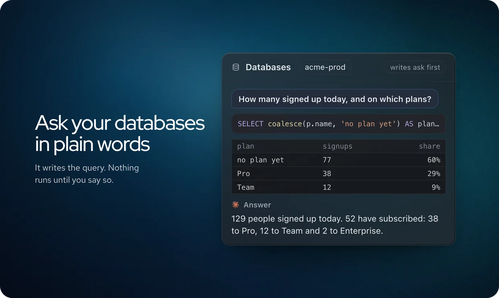
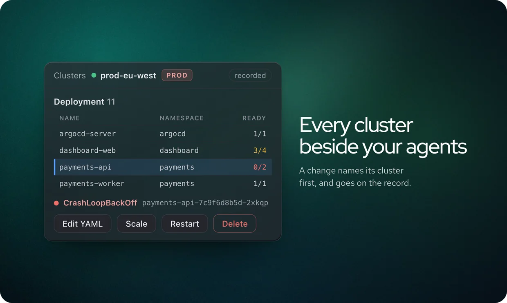
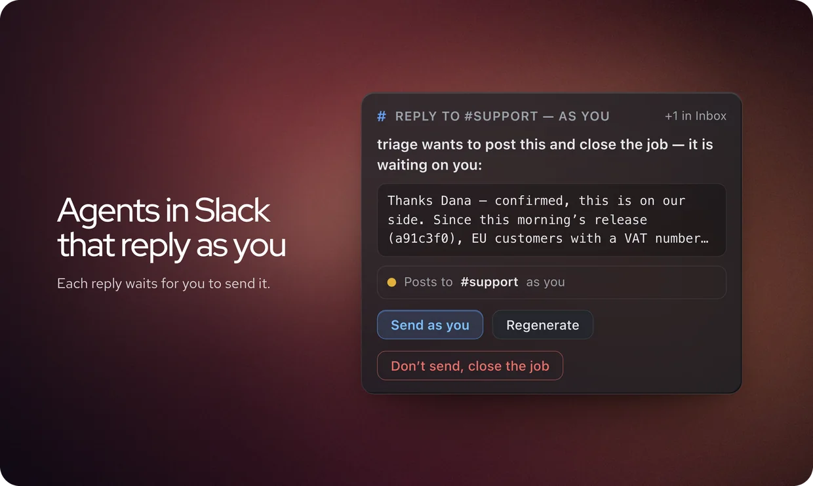
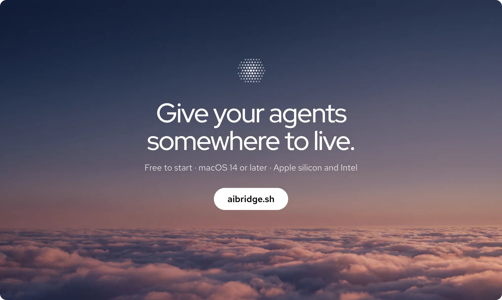

  

  <b>AI Bridge is a Mac app that runs your AI agents like a team</b>, each in its place with its own job. 
See which one needs you, and pick any up tomorrow where it stopped.

  &nbsp;&nbsp;

  Free to start · macOS 14 or later · Apple silicon and <a href="https://aibridge.sh/download/x64?src=github">Intel</a> · Signed and notarised

 

## What it does

🧭 **Agents organised like a team.** Projects, workspaces and agents: every agent you start already knows the job.

📥 **One inbox for everything that needs you.** Questions, approvals and Slack jobs, in one list.

🖥️ **The whole fleet on one wall.** The sessions that matter today, side by side.

💻 **The real CLIs, on your own accounts.** Each agent runs its own CLI in a real terminal, on your own subscription. Your terminals and SSH hosts sit in the same window.

🗄️ **Ask your databases in plain words.** Postgres and MongoDB: it writes the query, and nothing runs until you say so.

☸️ **Every cluster beside your agents.** Kubernetes in the same window. A change names its cluster first, and goes on the record.

💬 **Agents in Slack that reply as you.** Each reply waits for you to send it.

  &nbsp;&nbsp;&nbsp;&nbsp;

  &nbsp;&nbsp;&nbsp;&nbsp;

  &nbsp;&nbsp;&nbsp;&nbsp;

## Install

1. Download the disk image for [Apple silicon](https://aibridge.sh/download/arm64?src=github) or [Intel](https://aibridge.sh/download/x64?src=github).
2. Open it and drag **AI Bridge** to Applications.
3. Open AI Bridge. Setup checks for the agent CLIs you use and can install the ones you're missing.

Updates come from this repository's [releases](../../releases). AI Bridge tells you when one is ready and downloads it only when you say so.

## Questions

**Is AI Bridge open source?** No, it's closed source. This repository holds the signed releases and the public issue tracker.

**Does it use my own AI subscription?** Yes. Each agent is its own CLI (Claude Code, Codex, Grok or OpenCode), signed in with your own account.

**Where does my work live?** On your Mac. Your workspaces are plain files in `~/Bridge`.

**What does it cost?** It's free to start. The plans are on [aibridge.sh](https://aibridge.sh/?src=github#pricing).

## Report a bug or suggest a feature

The easiest way is from inside AI Bridge: **Settings › Send feedback**, or **Help › Report a Bug** / **Help › Suggest a Feature**. AI Bridge helps you write it up, adds your versions if you want, shows you exactly what will be posted, and posts it from your GitHub account, or opens it here in your browser.

You can also open an issue here directly. Before you do, please search the [existing issues](../../issues): if yours is there, a 👍 on it helps more than a duplicate.

Issues are public and stay public. Leave out anything private: tokens, customer names, internal hostnames.

## Something private?

- **A security problem:** please report it privately, see [SECURITY.md](SECURITY.md). Never as a public issue.
- **Your licence, a payment or your account:** email [support@aibridge.sh](mailto:support@aibridge.sh).

 

  

  © 2026 CyberNucleus Pty Ltd, trading as AI Bridge sh. Proprietary software, licensed under the <a href="https://aibridge.sh/terms">AI Bridge Terms</a>. Signed and notarised under CyberNucleus Pty Ltd's Apple Developer ID.

